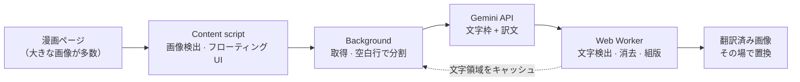

<div align="center">


# COMIC TRANS

**漫画・マンガ・縦読みウェブトゥーンをページ上でそのまま翻訳。元の文字を一画ずつ消して、訳文をその場に描き直します。**

[](https://github.com/ToanCreator/COMIC-TRANS/releases)
[](LICENSE)
[](#-無料オープンソース)
[](https://github.com/ToanCreator/COMIC-TRANS)
[](#-技術スタック)
[](#-コントリビュート)

[English](README.md) · [Tiếng Việt](README.vi.md) · [简体中文](README.zh-CN.md) · **🌐 日本語**

<!-- ⬇️ 下のリンクを実際のストアの URL に置き換えてください -->
[](https://addons.mozilla.org/firefox/addon/comic-trans/)
[](https://chromewebstore.google.com/detail/YOUR-EXTENSION-ID)
<!-- Chrome 版の公開後、"%E8%BF%91%E6%97%A5%E5%85%AC%E9%96%8B"（近日公開）を "%E6%8B%A1%E5%BC%B5%E6%A9%9F%E8%83%BD%E3%82%92%E5%85%A5%E6%89%8B"（拡張機能を入手）に変更 -->

</div>

---

<!-- 📸 ここにデモ GIF またはビフォー/アフター画像を追加してください。例：
<p align="center"></p>
-->

## ✨ COMIC TRANS とは？

多くの漫画翻訳ツールは、元の文字の上にテキストボックスを重ねるだけです。**COMIC TRANS** はさらに踏み込み、**元の文字を構成するピクセルを特定して消し、下の絵を補修し、訳文を描き込みます**。ページはまるで自分の言語で出版されたかのように仕上がります。

必要なのは**ご自身の [Google Gemini](https://ai.google.dev/) API キー**だけ。それ以外の処理――画像処理、文字消去、組版、キャッシュ――はすべて**ブラウザ内でローカルに実行**されます。

> モバイルファーストで設計（Firefox for Android に対応）。デスクトップでも快適に使えます。

## 🚀 機能

| | |
|---|---|
| 🧽 **本物の文字消去** | ぼやけた四角で塗りつぶすのではなく、元の文字を一画ずつ消します。吹き出しの枠線は残ります。 |
| 🖌️ **スマートな組版** | 訳文は吹き出しに収まるよう調整され、枠線や消していない線の手前で止まり、他の文字に重なりません。 |
| 📜 **ウェブトゥーン対応** | 長い縦画像は*コマとコマの間の空白行*で分割するため、文字が途中で切れません。 |
| ⚡ **高速・並列** | キーごとの並列数制限、HTTP 429 での自動減速と回復時の自動加速。キーを複数追加すれば速度が倍増します。 |
| 📱 **タッチ優先 UI** | フローティングボタン、タップで画像を選択、指で囲んで小さな文字を再翻訳、タッチ領域は 44px 以上。 |
| 🔁 **即時再描画** | 文字領域は画像ごとにキャッシュ。フォントやサイズを変えても**API を再呼び出しせず**すぐ描き直せます。 |
| 🧠 **自己修正** | 任意の校正ステップで意味不明な語や誤字を修正。ベトナム語の声調記号が欠けた場合は自動復元します。 |
| 📖 **用語集とトーンメモ** | 作品ごとに固有名詞を統一し、呼称や文体を指定できます。 |
| 📄 **PDF 書き出し** | 翻訳済みの章を PDF として保存（PDF ライブラリ不使用の自前生成）。 |
| 🌍 **180 以上の言語** | Gemini が対応する任意の言語ペアで翻訳。UI は **English / Tiếng Việt / 日本語 / 中文** に対応。 |
| 🔒 **設計段階からプライバシー重視** | アカウント不要、テレメトリなし、独自サーバーなし。[プライバシーとセキュリティ](#-プライバシーとセキュリティ)を参照。 |

## 📦 インストール

### Firefox（推奨）

1. アドオンページを開く → **[Firefox 版 COMIC TRANS を入手](https://addons.mozilla.org/firefox/addon/YOUR-ADDON-SLUG/)**
2. **Firefox に追加**をクリック。

### Chrome / Edge / Brave

近日公開予定です。[ロードマップ](#-ロードマップ)をご覧ください。進捗は [Issues](https://github.com/ToanCreator/COMIC-TRANS/issues) で確認できます。

### ソースから（任意の Firefox、開発者向け）

```bash
git clone https://github.com/ToanCreator/COMIC-TRANS.git
```

1. `about:debugging#/runtime/this-firefox` を開く
2. **Load Temporary Add-on…** をクリックして `manifest.json` を選択
3. 設定タブが自動で開きます。

> 一時的なアドオンは Firefox を閉じると削除されます。恒久的に使うには、ストア版を利用するか、`web-ext sign` で自分のビルドに署名してください。

## 🧭 クイックスタート

1. [Google AI Studio](https://aistudio.google.com/apikey) で**無料の Gemini API キーを取得**します。
2. **COMIC TRANS → 設定**を開き、キーを貼り付けます（1 行に 1 つ。キーが多いほど高速）。**キーを確認**を押します。
3. **原文の言語**と**翻訳先の言語**を選びます。
4. 任意の漫画ページを開き、**フローティングボタン**（右下、ドラッグ可）をタップします。

| モード | 動作 |
|---|---|
| **ページ全体を翻訳** | 表示中の画像を優先し、残りは並列処理 |
| **表示中の画像** | 画面中央にある画像のみ |
| **ここから下** | 現在の画像とそれ以降すべて――ウェブトゥーンに最適 |
| **タップして選択** | タップした画像だけを翻訳 |
| **範囲選択** | 小さな文字を囲むと拡大して読み取り、結果に統合 |
| **スクロールで自動翻訳** | これから表示される画像を先回りして翻訳 |
| **原文表示 / PDF 書き出し** | 比較や保存に |

**デスクトップのショートカット：** `Alt+Shift+T` パネル表示/非表示 · `Alt+Shift+Y` ページ全体を翻訳 · 画像を右クリック → *この画像を翻訳*。

## ⚙️ 仕組み



1. **検出** — content script が漫画サイズの画像（遅延読み込み含む）を見つけ、Shadow DOM の軽量な操作パネルを表示します。サイトの CSS と干渉しません。
2. **分割** — 長い画像は固定の高さではなく、コマ間で最も「静かな」水平行で切ります。
3. **モデルには*より少なく*頼む** — Gemini が返すのは、視覚モデルが得意な**文字枠・訳文・吹き出しの種類**（3 項目）だけ。重い処理は端末側で行います。
4. **本当の文字を見つける** — モデルの枠は小さすぎたりずれたりしがちなので、「種」としてのみ使います。Worker は同じ吹き出し内の隣接する線に沿って領域を広げ（局所背景への flood-fill、絵の上の文字には top-hat / black-hat モルフォロジー）、文字マスク全体を得ます。
5. **消去** — マスク内のピクセルを補完（push-pull 補完 + 絵に合わせた粒状ノイズ）し、修正箇所を絵になじませます。文字が見つからなければ、**画像には一切触れません**。
6. **組版** — 訳文を折り返し、吹き出しの空きスペースに収めます。枠線や消し残しの手前で止まります。
7. **キャッシュ** — 文字領域を画像ごとに保存。スタイル変更は即時かつ無料です。

## 🛠️ エンジニアリングのポイント

*興味のある方、そしてコードをレビューする方へ。*

- **依存関係ゼロ。** 素の JavaScript（ES2020）、WebExtension API、Web Worker。バンドラーもフレームワークもなく、実行時に `node_modules` は不要です。
- **テストしやすい純粋なコア。** `worker/core.js` は DOM に触れないため、同じアルゴリズムを Web Worker でも Node（テスト）でも実行できます。
- **コンピュータビジョンの処理をゼロから実装。** 支配色の解析、行/列ごとの文字統計、モルフォロジーの opening/closing、連結成分のグルーピング、push-pull インペインティング、ノイズ推定と粒状感の合成、IoU による重複排除。
- **堅牢な API クライアント。** 小さなテスト画像で各モデルが受け付ける設定（thinking → safety → JSON スキーマ）を調べ、段階的に縮退。途切れた JSON を救出し、キーごとの適応的な並列数で 429 に対処し、同一プロジェクトでクォータを共有するキーも検出します。
- **ページを固めない。** 重いピクセル処理は CPU コア数に応じた Worker プールで実行します。
- **PDF ライターも自作。** 章の書き出しは、手書きの小さな PDF シリアライザで生成します。
- **最初から多言語対応。** UI は 4 言語、ブラウザの言語から自動判定します。
- **多層のテスト。** 合成した漫画ページでのアルゴリズムテスト、単体・フローテスト（モデルの設定拒否、クォータ 0、429、JSON の途切れ、不正なキー、404、任意権限の欠落）、そして Playwright によるモバイルビューポートでの実ブラウザ E2E / タッチ UI テスト。

## 🔒 プライバシーとセキュリティ

- **API キーはブラウザ内にのみ保存**（`browser.storage.local`）され、`generativelanguage.googleapis.com` **にのみ**送信されます。
- 拡張機能は**他のどのサーバーとも通信しません**。アナリティクスも追跡もアカウントもありません。
- ⚠️ 翻訳のため、**選択した画像は Google の Gemini API に送信されます**。お使いのキーのプランに応じた Google の規約が適用されます（無料枠のデータは Google の現行ポリシーに基づき利用される場合があります。必ずご自身でご確認ください）。送信したくないコンテンツは翻訳しないでください。
- `x-goog-api-key` ヘッダーが写ったスクリーンショットは共有しないでください。キーが漏れた場合は、無効化して新しいキーを作成してください。

## 🧰 技術スタック

`JavaScript` · `WebExtensions（Firefox、Manifest V2）` · `Web Workers` · `Canvas / ImageData` · `Google Gemini API` · `Node.js + Playwright（テスト）`

## 🗂️ プロジェクト構成

```
COMIC-TRANS/
├── manifest.json          # WebExtension マニフェスト
├── background/
│   ├── main.js            # 制御：取得、分割、キュー、キャッシュ、キーごとの並列数
│   ├── gemini.js          # Gemini クライアント：プロンプト、解析、リトライ、自己診断
│   └── settings.js        # 既定値と保存
├── content/content.js     # 画像検出、フローティングパネル（Shadow DOM）、タッチ操作、PDF 書き出し
├── worker/
│   ├── core.js            # 純粋なアルゴリズム：文字マスク、インペイント、組版、分割
│   └── worker.js          # Web Worker ラッパー
├── options/               # 設定ページ
├── shared/                # UI 文言（en/vi/ja/zh）と言語一覧
└── tests/                 # 単体・フロー・アルゴリズム・ブラウザ E2E テスト
```

## 🧪 開発とテスト

```bash
cd tests
python3 make_synth.py && python3 make_tall.py && python3 make_widths.py   # 合成漫画ページを生成
node test_units.js && node test_flow.js && node run_core.js               # 単体 + フロー + コア
node browser_worker_test.js && node browser_content_test.js && node browser_e2e_test.js  # Playwright + Chromium が必要
```

> **正直な現状：** 自動テストは **Chromium** 上で、実際の Worker・content script・background の流れを使い、Gemini をモックして実行しています。実際の Firefox（デスクトップ/Android）、本物の Gemini API、数多くの実在する漫画サイトでの検証は進行中です。バグ報告は大歓迎です。

## ⚠️ 既知の制限

- 描き込みの多い絵の上に直接ある文字はきれいに消えますが、補完箇所がやや柔らかく見えることがあります（ニューラルインペインティングは未対応。気になる場合は*「絵の上に直接ある文字」*をオフにしてください）。
- 回転・湾曲した文字や吹き出しの枠に接した文字は特別扱いしていません。縦書きは文字サイズの推定のみです。
- システムにインストールされたフォントのみ使用します（翻訳先の言語に必要な字形を持つフォントを選んでください）。
- `<iframe>` 内の画像には未対応です。

## 📍 ロードマップ

- [ ] 🟦 **Chrome / Edge / Brave** 版（Manifest V3、offscreen document）
- [ ] 🧠 絵の上の文字向けニューラルインペインティング（`onnxruntime-web` / WebGPU 経由の LaMa）
- [ ] 🖥️ 任意のセルフホストモード（GPU 上で検出 + OCR + インペインティング。Gemini はテキスト翻訳のみ）
- [ ] ⏩ ストリーミング応答で、モデルの完了前から描画を開始
- [ ] 🌐 UI 言語の追加（PR 歓迎！）

## 🤝 コントリビュート

大小を問わず、あらゆる貢献を歓迎します。バグ報告、UI の翻訳、アルゴリズム改善、ドキュメントなど。

1. リポジトリを Fork してブランチを作成：`git checkout -b feature/my-idea`
2. 変更を加え、`tests/` のテストを実行
3. *何を*、*なぜ*変更したかを書いて Pull Request を作成

**この README や UI の翻訳：** `README.md` を `README.<言語コード>.md`（例：`README.ko.md`）にコピーし、冒頭の言語バーに追加してください。UI 文言は `shared/i18n.js` にあります。

## 💚 無料・オープンソース

COMIC TRANS は **100% 無料**（広告なし、課金なし、有料プランなし）で、**MIT ライセンス**のもと**オープンソース**です。読んで、Fork して、学んで、改良してください。お使いの API プランの無料枠を超えた場合にのみ、Google へ直接料金をお支払いいただきます。

## 📄 ライセンス

[MIT ライセンス](LICENSE)で公開しています。翻訳した漫画やウェブトゥーンの権利は原作者に帰属します。原作者を応援し、著作権と各サイトの利用規約を尊重してください。

## 👤 作者

**[ToanCreator](https://github.com/ToanCreator)** が ☕ とともに制作しました。
このプロジェクトが役に立ったら、リポジトリに ⭐ をいただけると励みになります！

<div align="center">

[⬆ ページ上部へ](#comic-trans)

</div>
