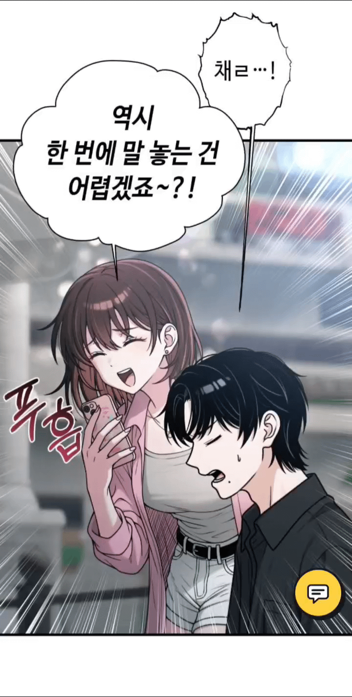
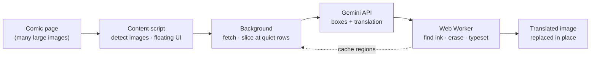

<div align="center">


# COMIC TRANS

**Translate comics, manga & webtoons right on the page — the original text is erased stroke by stroke, then the translation is redrawn in place.**

[](https://github.com/ToanCreator/COMIC-TRANS/releases)
[](LICENSE)
[](#-free--open-source)
[](https://github.com/ToanCreator/COMIC-TRANS)
[](#-tech-stack)
[](#-contributing)

**🌐 English** · [Tiếng Việt](README.vi.md) · [简体中文](README.zh-CN.md) · [日本語](README.ja.md)

<!-- ⬇️ Replace the links below with your real store URLs -->
[](https://addons.mozilla.org/firefox/addon/comic-trans/)
[](https://chromewebstore.google.com/detail/YOUR-EXTENSION-ID)
<!-- When the Chrome version is published, change "Coming%20soon" to "Get%20the%20extension" -->

</div>

---

<p align="center"></p>

## ✨ What is COMIC TRANS?

Most comic translators just paste a text box on top of the original lettering. **COMIC TRANS** goes further: it **detects the actual ink pixels of the original text, erases them, repairs the artwork underneath, and redraws the translation** so the page looks like it was published in your language.

You bring your own [Google Gemini](https://ai.google.dev/) API key. Everything else — image processing, text removal, typesetting, caching — runs **locally in your browser**.

> Built mobile-first (Firefox for Android works), but it feels just as good on desktop.

## 🚀 Features

| | |
|---|---|
| 🧽 **Real text removal** | Erases the original lettering stroke by stroke, not with a blurry rectangle. Speech-bubble borders stay intact. |
| 🖌️ **Smart typesetting** | The translation is fitted inside the bubble, stops at borders and untouched artwork, and never overlaps other text. |
| 📜 **Webtoon-friendly** | Long strips are sliced at *empty rows between panels*, so lettering is never cut in half. |
| ⚡ **Fast & parallel** | Per-key concurrency limits, automatic slow-down on HTTP 429 and automatic speed-up when things recover. Add several keys to multiply throughput. |
| 📱 **Touch-first UI** | Floating button, tap-to-pick an image, finger-drawn selection to re-translate tiny text, 44px+ touch targets. |
| 🔁 **Instant re-render** | Text regions are cached per image — change the font or size and the page redraws **without another API call**. |
| 🧠 **Self-correcting** | Optional proofreading pass fixes nonsense words / typos; Vietnamese diacritics are auto-restored if the model drops them. |
| 📖 **Glossary & tone notes** | Keep names consistent, define pronouns and speech style per series. |
| 📄 **Export to PDF** | Save the translated chapter as a PDF (generated in-house, no PDF library). |
| 🌍 **180+ languages** | Translate between any pair Gemini supports. UI in **English, Tiếng Việt, 日本語, 中文**. |
| 🔒 **Private by design** | No account, no telemetry, no server of ours. See [Privacy](#-privacy--security). |

## 📦 Installation

### Firefox (recommended)

1. Open the add-on page → **[Get COMIC TRANS for Firefox](https://addons.mozilla.org/firefox/addon/YOUR-ADDON-SLUG/)**
2. Click **Add to Firefox**.

### Chrome / Edge / Brave

Coming soon — see the [Roadmap](#-roadmap). Track progress in the [issues](https://github.com/ToanCreator/COMIC-TRANS/issues).

### From source (any Firefox, for developers)

```bash
git clone https://github.com/ToanCreator/COMIC-TRANS.git
```

1. Open `about:debugging#/runtime/this-firefox`
2. Click **Load Temporary Add-on…** and select `manifest.json`
3. The Settings tab opens automatically.

> Temporary add-ons are removed when Firefox closes. For a permanent install, use the store version or sign your own build with `web-ext sign`.

## 🧭 Quick start

1. **Get a free Gemini API key** at [Google AI Studio](https://aistudio.google.com/apikey).
2. Open **COMIC TRANS → Settings**, paste the key (one per line — more keys = more speed), press **Test key**.
3. Pick your **source** and **target** language.
4. Open any comic page and tap the **floating button** (bottom-right, draggable).

| Mode | What it does |
|---|---|
| **Translate page** | Visible images first, the rest in parallel |
| **Current image** | Only the image in the middle of the screen |
| **From here down** | Current image + everything below — perfect for webtoons |
| **Tap to pick** | Tap any image to translate just that one |
| **Select area** | Draw around tiny text; the area is zoomed in and merged into the result |
| **Auto-translate on scroll** | Upcoming images are translated before you reach them |
| **View original / Export PDF** | Compare or save your work |

**Desktop shortcuts:** `Alt+Shift+T` show/hide panel · `Alt+Shift+Y` translate page · right-click an image → *Translate this image*.

## ⚙️ How it works



1. **Detect** — the content script finds comic-sized images (including lazy-loaded ones) and shows a lightweight Shadow-DOM control panel that can't clash with the site's CSS.
2. **Slice** — long strips are cut at the quietest horizontal rows between panels, not at fixed heights.
3. **Ask the model for *less*** — Gemini only returns what a vision model is good at: **text boxes, the translation, and a bubble type** (3 fields). Heavy lifting stays on-device.
4. **Find the real ink** — the model's boxes are often too small or shifted, so they are used only as *seeds*. The Worker grows them along neighbouring strokes inside the same speech bubble (flood-fill on the local background; top-hat / black-hat morphology for text on artwork) to get the full lettering mask.
5. **Erase** — pixels inside the mask are inpainted (push-pull fill + matched film grain), so edits blend with the artwork. If no text is found, **the image is left untouched**.
6. **Typeset** — the translation is wrapped and fitted into the free area of the bubble, stopping before borders or any ink that wasn't erased.
7. **Cache** — regions are saved per image; restyling is instant and free.

## 🛠️ Engineering highlights

*For the curious — and for anyone reviewing the code.*

- **Zero dependencies.** Vanilla JavaScript (ES2020), WebExtension APIs, Web Workers. No bundler, no framework, no `node_modules` at runtime.
- **Pure, testable core.** `worker/core.js` has no DOM access, so the same algorithms run in a Web Worker **and** in Node for tests.
- **Computer-vision pipeline from scratch.** Dominant-colour analysis, row/column ink statistics, morphological opening/closing, connected-component grouping, push-pull inpainting, noise estimation + grain synthesis, IoU de-duplication.
- **Resilient API client.** Probes what each model accepts (thinking → safety → JSON-schema) with a tiny test image and degrades gracefully; salvages truncated JSON; handles 429 with per-key adaptive concurrency; detects keys that share a quota project.
- **Never blocks the page.** Heavy pixel work runs in a pool of Workers sized to the CPU core count.
- **Own PDF writer.** The chapter export is generated by a small hand-written PDF serializer.
- **i18n from day one.** Four UI languages, auto-detected from the browser.
- **Tested in layers.** Algorithm tests on synthetic comic pages, unit & flow tests (model refusals, quota 0, 429, truncated JSON, bad key, 404, missing optional permissions), and real-browser E2E / touch-UI tests with Playwright in a mobile viewport.

## 🔒 Privacy & security

- Your **API key is stored only in your browser** (`browser.storage.local`) and is sent **only** to `generativelanguage.googleapis.com`.
- The extension talks to **no other server** — no analytics, no tracking, no account.
- ⚠️ To translate, **the images you choose are sent to Google's Gemini API**. Google's terms for your key's plan apply (free-tier data may be used by Google per their current policy — please read it). Don't translate content you aren't comfortable sending.
- Never share screenshots exposing the `x-goog-api-key` header. If a key leaks, revoke it and create a new one.

## 🧰 Tech stack

`JavaScript` · `WebExtensions (Firefox, Manifest V2)` · `Web Workers` · `Canvas / ImageData` · `Google Gemini API` · `Node.js + Playwright (tests)`

## 🗂️ Project structure

```
COMIC-TRANS/
├── manifest.json          # WebExtension manifest
├── background/
│   ├── main.js            # orchestration: fetch, slice, queue, cache, per-key concurrency
│   ├── gemini.js          # Gemini client: prompts, parsing, retries, self-test
│   └── settings.js        # defaults & storage
├── content/content.js     # image detection, floating panel (Shadow DOM), touch gestures, PDF export
├── worker/
│   ├── core.js            # pure algorithms: ink mask, inpainting, typesetting, slicing
│   └── worker.js          # Web Worker wrapper
├── options/               # settings page
├── shared/                # i18n strings (en/vi/ja/zh) & language list
└── tests/                 # unit, flow, algorithm and browser E2E tests
```

## 🧪 Development & tests

```bash
cd tests
python3 make_synth.py && python3 make_tall.py && python3 make_widths.py   # synthetic comic pages
node test_units.js && node test_flow.js && node run_core.js               # unit + flow + core
node browser_worker_test.js && node browser_content_test.js && node browser_e2e_test.js  # needs Playwright + Chromium
```

> **Honest status:** automated tests ran against the real Worker, content script and background flow in **Chromium** with Gemini mocked. Testing on real Firefox (desktop & Android), the live Gemini API and many real manga sites is ongoing — bug reports are very welcome.

## ⚠️ Known limitations

- Text drawn directly over highly detailed artwork is erased cleanly but the fill can look slightly soft (no neural inpainting yet — turn off *"Text directly on artwork"* if you prefer).
- Rotated / curved text and lettering glued to bubble borders are not handled specially; vertical text is only size-estimated.
- Only fonts installed on your system are used (choose one with the glyphs your target language needs).
- Images inside `<iframe>`s are not supported yet.

## 📍 Roadmap

- [ ] 🟦 **Chrome / Edge / Brave** version (Manifest V3, offscreen document)
- [ ] 🧠 Neural inpainting (LaMa via `onnxruntime-web` / WebGPU) for text on artwork
- [ ] 🖥️ Optional self-hosted mode (detector + OCR + inpainting on GPU; Gemini translates text only)
- [ ] ⏩ Streaming responses so drawing starts before the model finishes
- [ ] 🌐 More UI languages (PRs welcome!)

## 🤝 Contributing

Contributions of any size are welcome — bug reports, new UI translations, algorithm improvements, docs.

1. Fork the repo and create a branch: `git checkout -b feature/my-idea`
2. Make your change and run the tests in `tests/`
3. Open a Pull Request describing *what* and *why*

**Translate this README or the UI:** copy `README.md` to `README.<lang>.md` (for example `README.ko.md`) and add it to the language bar at the top; UI strings live in `shared/i18n.js`.

## 💚 Free & open source

COMIC TRANS is **100% free** — no ads, no paywall, no premium tier — and **open source** under the **MIT License**. Read it, fork it, learn from it, improve it. You only pay Google directly for API usage *if* you exceed your plan's free quota.

## 📄 License

Released under the [MIT License](LICENSE). Comics and webtoons you translate remain the property of their creators — please support the original authors and respect copyright and each site's terms of use.

## 👤 Author

Made with ☕ by **[ToanCreator](https://github.com/ToanCreator)**.
If this project helped you, a ⭐ on the repo means a lot!

<div align="center">

[⬆ Back to top](#comic-trans)

</div>
