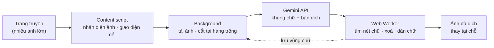

<div align="center">


# COMIC TRANS

**Dịch truyện tranh, manga và webtoon ngay trên trang web — chữ gốc được xoá theo từng nét, bản dịch được vẽ lại đúng chỗ.**

[](https://github.com/ToanCreator/COMIC-TRANS/releases)
[](LICENSE)
[](#-miễn-phí--mã-nguồn-mở)
[](https://github.com/ToanCreator/COMIC-TRANS)
[](#-công-nghệ)
[](#-đóng-góp)

[English](README.md) · **🌐 Tiếng Việt** · [简体中文](README.zh-CN.md) · [日本語](README.ja.md)

<!-- ⬇️ Thay các liên kết bên dưới bằng đường dẫn thật trên cửa hàng tiện ích -->
[](https://addons.mozilla.org/firefox/addon/comic-trans/)
[](https://chromewebstore.google.com/detail/YOUR-EXTENSION-ID)
<!-- Khi bản Chrome được phát hành, đổi "S%E1%BA%AFp%20ra%20m%E1%BA%AFt" thành "T%E1%BA%A3i%20ti%E1%BB%87n%20%C3%ADch" -->

</div>

---

<!-- 📸 Thêm ảnh GIF demo hoặc ảnh trước/sau tại đây, ví dụ:
<p align="center"></p>
-->

## ✨ COMIC TRANS là gì?

Phần lớn công cụ dịch truyện chỉ dán một khung chữ đè lên chữ gốc. **COMIC TRANS** đi xa hơn: tiện ích **tìm đúng các điểm ảnh của chữ gốc, xoá chúng, vá lại nền tranh bên dưới rồi vẽ bản dịch vào**, để trang truyện trông như được phát hành bằng ngôn ngữ của bạn.

Bạn dùng **API key [Google Gemini](https://ai.google.dev/) của chính mình**. Mọi việc còn lại — xử lý ảnh, xoá chữ, dàn chữ, lưu bộ nhớ đệm — đều chạy **ngay trong trình duyệt của bạn**.

> Thiết kế ưu tiên điện thoại (chạy được trên Firefox Android), nhưng dùng trên máy tính cũng rất mượt.

## 🚀 Tính năng

| | |
|---|---|
| 🧽 **Xoá chữ thật sự** | Xoá chữ gốc theo từng nét chứ không tô hình chữ nhật nhoè. Viền bong bóng được giữ nguyên. |
| 🖌️ **Dàn chữ thông minh** | Bản dịch được xếp vừa trong bong bóng, dừng khi chạm viền hoặc nét chưa xoá, không đè lên chữ khác. |
| 📜 **Hợp webtoon** | Ảnh dài được cắt tại *hàng trống giữa các khung tranh*, không bao giờ cắt ngang chữ. |
| ⚡ **Nhanh, song song** | Giới hạn song song riêng cho từng key, tự giảm tốc khi gặp lỗi 429 và tự tăng lại khi ổn. Thêm nhiều key để nhân tốc độ. |
| 📱 **Giao diện cảm ứng** | Nút nổi, chạm để chọn ảnh, khoanh vùng bằng ngón tay để dịch lại chữ nhỏ, vùng chạm ≥ 44px. |
| 🔁 **Vẽ lại tức thì** | Vùng chữ được lưu theo từng ảnh — đổi phông hoặc cỡ chữ là vẽ lại ngay, **không tốn thêm lượt gọi API**. |
| 🧠 **Tự sửa lỗi** | Bước rà soát tuỳ chọn sửa từ vô nghĩa/sai chính tả; tiếng Việt tự được khôi phục dấu nếu model trả câu không dấu. |
| 📖 **Thuật ngữ & ghi chú** | Giữ nhất quán tên riêng, quy định xưng hô và văn phong cho từng bộ truyện. |
| 📄 **Xuất PDF** | Lưu chương đã dịch thành PDF (tự sinh, không dùng thư viện PDF). |
| 🌍 **180+ ngôn ngữ** | Dịch giữa mọi cặp ngôn ngữ mà Gemini hỗ trợ. Giao diện có **English, Tiếng Việt, 日本語, 中文**. |
| 🔒 **Riêng tư từ thiết kế** | Không tài khoản, không theo dõi, không máy chủ riêng. Xem [Quyền riêng tư](#-quyền-riêng-tư--bảo-mật). |

## 📦 Cài đặt

### Firefox (khuyên dùng)

1. Mở trang tiện ích → **[Tải COMIC TRANS cho Firefox](https://addons.mozilla.org/firefox/addon/YOUR-ADDON-SLUG/)**
2. Bấm **Thêm vào Firefox**.

### Chrome / Edge / Brave

Sắp ra mắt — xem [Lộ trình](#-lộ-trình). Theo dõi tiến độ tại [Issues](https://github.com/ToanCreator/COMIC-TRANS/issues).

### Từ mã nguồn (mọi bản Firefox, dành cho lập trình viên)

```bash
git clone https://github.com/ToanCreator/COMIC-TRANS.git
```

1. Mở `about:debugging#/runtime/this-firefox`
2. Bấm **Load Temporary Add-on…** và chọn file `manifest.json`
3. Tab Cài đặt sẽ tự mở.

> Tiện ích tạm thời sẽ mất khi tắt Firefox. Muốn cài vĩnh viễn, hãy dùng bản trên cửa hàng hoặc tự ký bản build bằng `web-ext sign`.

## 🧭 Bắt đầu nhanh

1. **Lấy API key Gemini miễn phí** tại [Google AI Studio](https://aistudio.google.com/apikey).
2. Mở **COMIC TRANS → Cài đặt**, dán key (mỗi dòng một key — nhiều key = nhanh hơn), bấm **Kiểm tra key**.
3. Chọn **ngôn ngữ gốc** và **ngôn ngữ đích**.
4. Mở một trang truyện bất kỳ và chạm vào **nút nổi** (góc phải dưới, kéo được).

| Chế độ | Công dụng |
|---|---|
| **Dịch cả trang** | Ảnh đang xem dịch trước, các ảnh khác chạy song song |
| **Ảnh đang xem** | Chỉ dịch ảnh ở giữa màn hình |
| **Từ đây trở xuống** | Ảnh hiện tại và mọi ảnh phía sau — hợp đọc webtoon |
| **Chạm để chọn ảnh** | Chạm vào ảnh nào thì dịch ảnh đó |
| **Khoanh vùng** | Khoanh quanh chữ nhỏ; vùng được phóng to rồi gộp vào kết quả |
| **Tự dịch khi cuộn tới** | Ảnh sắp cuộn tới được dịch trước |
| **Xem gốc / Xuất PDF** | So sánh hoặc lưu thành quả |

**Phím tắt trên máy tính:** `Alt+Shift+T` hiện/ẩn bảng · `Alt+Shift+Y` dịch cả trang · chuột phải lên ảnh → *Dịch ảnh này*.

## ⚙️ Cơ chế hoạt động



1. **Nhận diện** — content script tìm các ảnh cỡ truyện (kể cả ảnh tải lười) và hiện bảng điều khiển nhẹ trong Shadow DOM, không đụng CSS của trang.
2. **Cắt lát** — ảnh dài được cắt tại những hàng ngang yên tĩnh nhất giữa các khung tranh, không cắt theo chiều cao cố định.
3. **Giao cho model *ít việc hơn*** — Gemini chỉ trả về phần mà mô hình thị giác làm tốt: **khung chữ, bản dịch và loại bong bóng** (3 trường). Phần nặng được xử lý ngay trên máy.
4. **Tìm đúng nét chữ** — khung của model thường nhỏ hơn hoặc lệch so với chữ thật, nên chỉ dùng làm "hạt giống". Worker lan theo các nét chữ sát nhau trong cùng bong bóng (flood-fill trên nền cục bộ; top-hat / black-hat cho chữ nằm trên tranh) để có mặt nạ chữ đầy đủ.
5. **Xoá chữ** — các điểm ảnh trong mặt nạ được điền lại (push-pull + thêm hạt nhiễu cho khớp tranh) nên vùng sửa hoà vào nền. Nếu không tìm thấy chữ, **ảnh được giữ nguyên**.
6. **Dàn chữ** — bản dịch được ngắt dòng và xếp vừa vùng trống của bong bóng, dừng trước viền hoặc nét chưa xoá.
7. **Lưu đệm** — vùng chữ được lưu theo từng ảnh; đổi kiểu chữ là vẽ lại ngay, không tốn phí.

## 🛠️ Điểm nhấn kỹ thuật

*Dành cho người tò mò — và cho ai đang xem xét mã nguồn.*

- **Không phụ thuộc thư viện nào.** JavaScript thuần (ES2020), WebExtension API, Web Worker. Không bundler, không framework, không `node_modules` khi chạy.
- **Lõi thuần, dễ kiểm thử.** `worker/core.js` không chạm DOM, nên cùng một thuật toán chạy được trong Web Worker **và** trong Node để test.
- **Pipeline thị giác máy tính tự viết.** Phân tích màu chủ đạo, thống kê nét theo hàng/cột, phép toán hình thái học (mở/đóng), gom thành phần liên thông, inpainting push-pull, ước lượng nhiễu + tạo hạt, loại trùng bằng IoU.
- **Client API bền bỉ.** Tự dò model chấp nhận cấu hình nào (thinking → safety → JSON schema) bằng một ảnh nhỏ rồi hạ cấp êm; cứu JSON bị cắt giữa chừng; xử lý 429 bằng song song thích ứng theo từng key; nhận ra các key dùng chung hạn mức của một project.
- **Không làm đơ trang.** Phần xử lý điểm ảnh nặng chạy trong nhóm Worker có số lượng theo số nhân CPU.
- **Tự viết bộ xuất PDF.** Bản PDF được tạo bằng một bộ serializer PDF nhỏ viết tay.
- **Đa ngôn ngữ ngay từ đầu.** Giao diện 4 ngôn ngữ, tự nhận theo trình duyệt.
- **Kiểm thử nhiều tầng.** Test thuật toán trên trang truyện giả lập, test đơn vị và test luồng (model từ chối cấu hình, quota 0, 429, JSON bị cắt, key sai, 404, thiếu quyền tuỳ chọn), cùng test E2E/cảm ứng trên trình duyệt thật bằng Playwright ở khung nhìn điện thoại.

## 🔒 Quyền riêng tư & bảo mật

- **API key chỉ lưu trong trình duyệt của bạn** (`browser.storage.local`) và **chỉ** được gửi tới `generativelanguage.googleapis.com`.
- Tiện ích **không gọi máy chủ nào khác** — không phân tích, không theo dõi, không tài khoản.
- ⚠️ Để dịch, **các ảnh bạn chọn được gửi tới Gemini API của Google**. Áp dụng điều khoản của Google theo gói key của bạn (với key miễn phí, Google có thể dùng dữ liệu theo chính sách hiện hành — hãy tự đọc kỹ). Đừng dịch nội dung bạn không muốn gửi đi.
- Đừng chia sẻ ảnh chụp màn hình lộ header `x-goog-api-key`. Nếu lỡ lộ key, hãy thu hồi và tạo key mới.

## 🧰 Công nghệ

`JavaScript` · `WebExtensions (Firefox, Manifest V2)` · `Web Workers` · `Canvas / ImageData` · `Google Gemini API` · `Node.js + Playwright (kiểm thử)`

## 🗂️ Cấu trúc dự án

```
COMIC-TRANS/
├── manifest.json          # manifest của WebExtension
├── background/
│   ├── main.js            # điều phối: tải ảnh, cắt lát, hàng đợi, bộ nhớ đệm, song song theo key
│   ├── gemini.js          # client Gemini: prompt, phân tích kết quả, thử lại, tự kiểm tra
│   └── settings.js        # giá trị mặc định & lưu trữ
├── content/content.js     # nhận diện ảnh, bảng nổi (Shadow DOM), cử chỉ cảm ứng, xuất PDF
├── worker/
│   ├── core.js            # thuật toán thuần: mặt nạ chữ, inpainting, dàn chữ, cắt lát
│   └── worker.js          # lớp bọc Web Worker
├── options/               # trang cài đặt
├── shared/                # chuỗi giao diện (en/vi/ja/zh) & danh sách ngôn ngữ
└── tests/                 # test đơn vị, luồng, thuật toán và E2E trên trình duyệt
```

## 🧪 Phát triển & kiểm thử

```bash
cd tests
python3 make_synth.py && python3 make_tall.py && python3 make_widths.py   # tạo trang truyện giả lập
node test_units.js && node test_flow.js && node run_core.js               # đơn vị + luồng + lõi
node browser_worker_test.js && node browser_content_test.js && node browser_e2e_test.js  # cần Playwright + Chromium
```

> **Tình trạng thực tế:** các test tự động đã chạy với Worker thật, content script thật và luồng background thật trong **Chromium**, với Gemini được giả lập. Việc kiểm thử trên Firefox thật (máy tính & Android), Gemini API thật và nhiều trang truyện thật vẫn đang tiếp tục — rất hoan nghênh báo lỗi.

## ⚠️ Giới hạn đã biết

- Chữ nằm trực tiếp trên tranh nhiều chi tiết được xoá sạch nhưng chỗ điền lại có thể hơi mờ (chưa có inpainting thần kinh — tắt mục *"Chữ nằm trực tiếp trên tranh"* nếu không ưng).
- Chữ xoay nghiêng/cong và chữ dính sát viền bong bóng chưa được xử lý riêng; chữ dọc chỉ ước lượng cỡ.
- Chỉ dùng phông đã cài trong máy (hãy chọn phông có đủ ký tự cho ngôn ngữ đích).
- Ảnh nằm trong `<iframe>` chưa được hỗ trợ.

## 📍 Lộ trình

- [ ] 🟦 Bản **Chrome / Edge / Brave** (Manifest V3, offscreen document)
- [ ] 🧠 Inpainting thần kinh (LaMa qua `onnxruntime-web` / WebGPU) cho chữ trên tranh
- [ ] 🖥️ Chế độ máy chủ riêng tuỳ chọn (detector + OCR + inpainting trên GPU; Gemini chỉ dịch văn bản)
- [ ] ⏩ Streaming phản hồi để bắt đầu vẽ trước khi model trả xong
- [ ] 🌐 Thêm ngôn ngữ giao diện (hoan nghênh PR!)

## 🤝 Đóng góp

Mọi đóng góp, dù nhỏ, đều được chào đón — báo lỗi, bản dịch giao diện, cải tiến thuật toán, tài liệu.

1. Fork repo và tạo nhánh: `git checkout -b feature/y-tuong-cua-ban`
2. Thực hiện thay đổi và chạy các test trong `tests/`
3. Mở Pull Request mô tả *làm gì* và *vì sao*

**Dịch README hoặc giao diện:** sao chép `README.md` thành `README.<mã-ngôn-ngữ>.md` (ví dụ `README.ko.md`) và thêm vào thanh ngôn ngữ ở đầu trang; chuỗi giao diện nằm trong `shared/i18n.js`.

## 💚 Miễn phí & mã nguồn mở

COMIC TRANS **miễn phí 100%** — không quảng cáo, không thu phí, không gói trả phí — và là **mã nguồn mở** theo **Giấy phép MIT**. Bạn có thể đọc, fork, học hỏi và cải tiến. Bạn chỉ trả tiền trực tiếp cho Google khi vượt hạn mức miễn phí của gói API.

## 📄 Giấy phép

Phát hành theo [Giấy phép MIT](LICENSE). Truyện tranh và webtoon bạn dịch vẫn thuộc quyền sở hữu của tác giả — hãy ủng hộ tác giả gốc, tôn trọng bản quyền và điều khoản sử dụng của từng trang web.

## 👤 Tác giả

Được làm bằng ☕ bởi **[ToanCreator](https://github.com/ToanCreator)**.
Nếu dự án giúp ích cho bạn, một ⭐ trên repo là niềm động viên rất lớn!

<div align="center">

[⬆ Lên đầu trang](#comic-trans)

</div>
