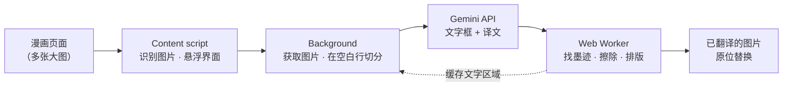

<div align="center">


# COMIC TRANS

**在网页上直接翻译漫画、日漫和条漫——逐笔擦除原文，再把译文原位重绘。**

[](https://github.com/ToanCreator/COMIC-TRANS/releases)
[](LICENSE)
[](#-免费与开源)
[](https://github.com/ToanCreator/COMIC-TRANS)
[](#-技术栈)
[](#-参与贡献)

[English](README.md) · [Tiếng Việt](README.vi.md) · **🌐 简体中文** · [日本語](README.ja.md)

<!-- ⬇️ 请把下面的链接替换为真实的商店地址 -->
[](https://addons.mozilla.org/firefox/addon/YOUR-ADDON-SLUG/)
[](https://chromewebstore.google.com/detail/YOUR-EXTENSION-ID)
<!-- Chrome 版发布后，把 "%E5%8D%B3%E5%B0%86%E6%8E%A8%E5%87%BA"（即将推出）改为 "%E8%8E%B7%E5%8F%96%E6%89%A9%E5%B1%95"（获取扩展） -->

</div>

---

<!-- 📸 在此添加演示 GIF 或前后对比截图，例如：
<p align="center"></p>
-->

## ✨ COMIC TRANS 是什么？

大多数漫画翻译工具只是在原文上盖一个文本框。**COMIC TRANS** 走得更远：它会**识别原文真正的墨迹像素、将其擦除、修补下方的画面，再把译文重新绘制上去**，让整页看起来就像用你的语言正式出版的一样。

你只需使用**自己的 [Google Gemini](https://ai.google.dev/) API 密钥**。其余所有工作——图像处理、文字擦除、排版、缓存——都**在你的浏览器本地完成**。

> 以手机端优先设计（支持 Firefox for Android），在桌面端同样流畅。

## 🚀 功能

| | |
|---|---|
| 🧽 **真正的文字擦除** | 逐笔擦除原文，而不是涂一块模糊的矩形。对话气泡的边框完整保留。 |
| 🖌️ **智能排版** | 译文适配气泡大小，遇到边框或未擦除的笔画就停止，不会覆盖其他文字。 |
| 📜 **适配条漫** | 长图在*分格之间的空白行*处切分，绝不会把文字切成两半。 |
| ⚡ **快速并行** | 每个密钥单独限流，遇到 HTTP 429 自动降速、恢复后自动提速。添加多个密钥可成倍提升速度。 |
| 📱 **触控优先界面** | 悬浮按钮、点按选图、手指圈选重译小字，触控目标不小于 44px。 |
| 🔁 **即时重绘** | 每张图的文字区域都会缓存——更换字体或字号后立即重绘，**无需再次调用 API**。 |
| 🧠 **自我纠错** | 可选的校对步骤会修正无意义词语/错别字；若模型丢失越南语声调，会自动补全。 |
| 📖 **术语表与语气备注** | 为每部作品保持人名一致，并约定称呼和文风。 |
| 📄 **导出 PDF** | 将译好的章节保存为 PDF（自行生成，不依赖 PDF 库）。 |
| 🌍 **180+ 种语言** | 支持 Gemini 能处理的任意语言对。界面提供 **English、Tiếng Việt、日本語、中文**。 |
| 🔒 **隐私优先** | 无需账号、无遥测、无自建服务器。详见[隐私与安全](#-隐私与安全)。 |

## 📦 安装

### Firefox（推荐）

1. 打开扩展页面 → **[获取 Firefox 版 COMIC TRANS](https://addons.mozilla.org/firefox/addon/YOUR-ADDON-SLUG/)**
2. 点击**添加到 Firefox**。

### Chrome / Edge / Brave

即将推出——见[路线图](#-路线图)。可在 [Issues](https://github.com/ToanCreator/COMIC-TRANS/issues) 关注进度。

### 从源码安装（任意 Firefox，面向开发者）

```bash
git clone https://github.com/ToanCreator/COMIC-TRANS.git
```

1. 打开 `about:debugging#/runtime/this-firefox`
2. 点击 **Load Temporary Add-on…** 并选择 `manifest.json`
3. 设置页会自动打开。

> 临时扩展会在关闭 Firefox 后移除。如需永久安装，请使用商店版本，或用 `web-ext sign` 为自己的构建签名。

## 🧭 快速上手

1. 在 [Google AI Studio](https://aistudio.google.com/apikey) **获取免费的 Gemini API 密钥**。
2. 打开 **COMIC TRANS → 设置**，粘贴密钥（每行一个——密钥越多越快），点击**检查密钥**。
3. 选择**源语言**和**目标语言**。
4. 打开任意漫画页面，点击**悬浮按钮**（右下角，可拖动）。

| 模式 | 作用 |
|---|---|
| **翻译整页** | 先翻译正在查看的图片，其余并行处理 |
| **当前图片** | 只翻译屏幕中央的图片 |
| **从此处向下** | 当前图片及其后的所有图片——最适合条漫 |
| **点按选图** | 点哪张图就翻译哪张 |
| **圈选区域** | 圈出小字，区域会被放大识别并合并进结果 |
| **滚动时自动翻译** | 即将滚动到的图片会提前翻译 |
| **查看原图 / 导出 PDF** | 对比或保存成果 |

**桌面快捷键：** `Alt+Shift+T` 显示/隐藏面板 · `Alt+Shift+Y` 翻译整页 · 右键图片 → *翻译此图片*。

## ⚙️ 工作原理



1. **识别**——content script 找出漫画尺寸的图片（包括懒加载图片），并显示一个基于 Shadow DOM 的轻量控制面板，不会与网站 CSS 冲突。
2. **切分**——长图在分格之间最“安静”的水平行处切开，而不是按固定高度。
3. **让模型做*更少*的事**——Gemini 只返回视觉模型擅长的部分：**文字框、译文和气泡类型**（3 个字段）。繁重的工作留在本地完成。
4. **找到真正的墨迹**——模型给出的框常常偏小或偏移，因此只作为“种子”。Worker 会沿着同一气泡内相邻的笔画向外扩展（对局部背景做 flood-fill；对画面上的文字使用 top-hat / black-hat 形态学），得到完整的文字掩膜。
5. **擦除**——掩膜内的像素被填补（push-pull 填充 + 匹配的颗粒噪点），使修改与原画融为一体。若没有找到文字，**图片保持原样不动**。
6. **排版**——译文经过换行后适配气泡的空白区域，并在边框或任何未擦除的笔画前停止。
7. **缓存**——文字区域按图片保存；调整样式即时完成，无需费用。

## 🛠️ 工程亮点

*写给好奇的你，也写给正在审阅代码的人。*

- **零依赖。** 原生 JavaScript（ES2020）、WebExtension API、Web Worker。没有打包器、没有框架，运行时没有 `node_modules`。
- **纯函数核心，易于测试。** `worker/core.js` 不访问 DOM，因此同一套算法既能在 Web Worker 中运行，也能在 Node 中测试。
- **从零实现的计算机视觉流程。** 主色分析、行/列墨迹统计、形态学开/闭运算、连通域分组、push-pull 修复、噪声估计与颗粒合成、基于 IoU 的去重。
- **健壮的 API 客户端。** 用一张小图探测每个模型接受哪些配置（thinking → safety → JSON schema）并平滑降级；抢救被截断的 JSON；按密钥自适应并发处理 429；识别共用同一项目配额的密钥。
- **不卡页面。** 繁重的像素处理在按 CPU 核心数确定大小的 Worker 池中运行。
- **自写 PDF 生成器。** 章节导出由一个手写的小型 PDF 序列化器完成。
- **从第一天起就支持多语言。** 四种界面语言，按浏览器自动识别。
- **分层测试。** 在合成漫画页上测试算法，单元与流程测试（模型拒绝配置、配额为 0、429、JSON 被截断、密钥错误、404、缺少可选权限），以及用 Playwright 在手机视口下做的真实浏览器 E2E / 触控界面测试。

## 🔒 隐私与安全

- 你的 **API 密钥仅保存在你的浏览器中**（`browser.storage.local`），并且**只会**发送到 `generativelanguage.googleapis.com`。
- 扩展**不与任何其他服务器通信**——无统计、无追踪、无账号。
- ⚠️ 翻译时，**你选择的图片会被发送到 Google 的 Gemini API**。适用 Google 针对你所用密钥套餐的条款（免费层的数据可能依 Google 现行政策被使用——请自行阅读）。请勿翻译你不愿意发送出去的内容。
- 切勿分享暴露 `x-goog-api-key` 请求头的截图。若密钥泄露，请立即撤销并重新创建。

## 🧰 技术栈

`JavaScript` · `WebExtensions（Firefox，Manifest V2）` · `Web Workers` · `Canvas / ImageData` · `Google Gemini API` · `Node.js + Playwright（测试）`

## 🗂️ 项目结构

```
COMIC-TRANS/
├── manifest.json          # WebExtension 清单
├── background/
│   ├── main.js            # 调度：获取图片、切分、队列、缓存、按密钥并发
│   ├── gemini.js          # Gemini 客户端：提示词、解析、重试、自检
│   └── settings.js        # 默认值与存储
├── content/content.js     # 图片识别、悬浮面板（Shadow DOM）、触控手势、PDF 导出
├── worker/
│   ├── core.js            # 纯算法：文字掩膜、修复、排版、切分
│   └── worker.js          # Web Worker 封装
├── options/               # 设置页
├── shared/                # 界面文案（en/vi/ja/zh）与语言列表
└── tests/                 # 单元、流程、算法与浏览器 E2E 测试
```

## 🧪 开发与测试

```bash
cd tests
python3 make_synth.py && python3 make_tall.py && python3 make_widths.py   # 生成合成漫画页
node test_units.js && node test_flow.js && node run_core.js               # 单元 + 流程 + 核心
node browser_worker_test.js && node browser_content_test.js && node browser_e2e_test.js  # 需要 Playwright + Chromium
```

> **真实状态：** 自动化测试是在 **Chromium** 中使用真实的 Worker、content script 和 background 流程，并模拟 Gemini 运行的。在真实 Firefox（桌面与 Android）、真实 Gemini API 以及众多真实漫画站点上的测试仍在进行中——非常欢迎提交 Bug 报告。

## ⚠️ 已知限制

- 直接画在细节丰富的画面上的文字可以被干净擦除，但填补处可能略显模糊（尚无神经网络修复——不满意可关闭*“文字直接位于画面上”*选项）。
- 旋转/弯曲的文字以及紧贴气泡边框的文字尚未做专门处理；竖排文字目前只估算字号。
- 仅使用系统已安装的字体（请选择包含目标语言所需字形的字体）。
- 暂不支持位于 `<iframe>` 中的图片。

## 📍 路线图

- [ ] 🟦 **Chrome / Edge / Brave** 版本（Manifest V3、offscreen document）
- [ ] 🧠 神经网络修复（通过 `onnxruntime-web` / WebGPU 运行 LaMa），用于画面上的文字
- [ ] 🖥️ 可选的自托管模式（在 GPU 上做检测 + OCR + 修复；Gemini 仅翻译文本）
- [ ] ⏩ 流式响应，使模型尚未完成时就开始绘制
- [ ] 🌐 更多界面语言（欢迎 PR！）

## 🤝 参与贡献

无论大小，任何贡献都欢迎——Bug 报告、界面翻译、算法改进、文档。

1. Fork 本仓库并创建分支：`git checkout -b feature/my-idea`
2. 完成修改并运行 `tests/` 中的测试
3. 提交 Pull Request，说明*做了什么*以及*为什么*

**翻译本 README 或界面：** 将 `README.md` 复制为 `README.<语言代码>.md`（例如 `README.ko.md`），并加入顶部的语言栏；界面文案位于 `shared/i18n.js`。

## 💚 免费与开源

COMIC TRANS **完全免费**——没有广告、没有付费墙、没有高级版——并以 **MIT 许可证**开源。欢迎阅读、Fork、学习和改进。仅当你超出所用套餐的免费额度时，才需要直接向 Google 付费。

## 📄 许可证

基于 [MIT 许可证](LICENSE)发布。你翻译的漫画和条漫版权仍归原作者所有——请支持原作者，并尊重版权及各网站的使用条款。

## 👤 作者

由 **[ToanCreator](https://github.com/ToanCreator)** 用 ☕ 制作。
如果这个项目对你有帮助，给仓库点个 ⭐ 就是莫大的鼓励！

<div align="center">

[⬆ 回到顶部](#comic-trans)

</div>
